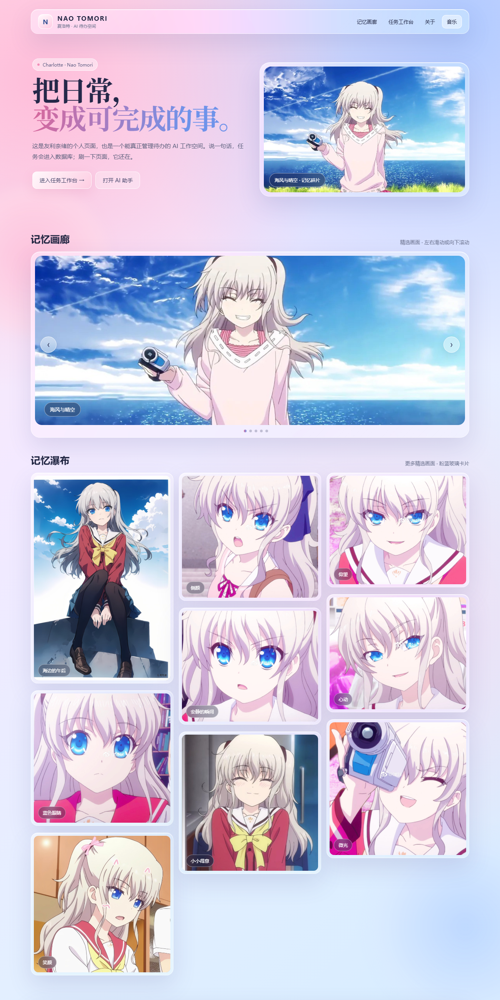
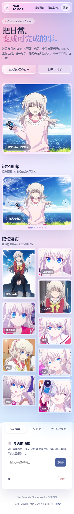
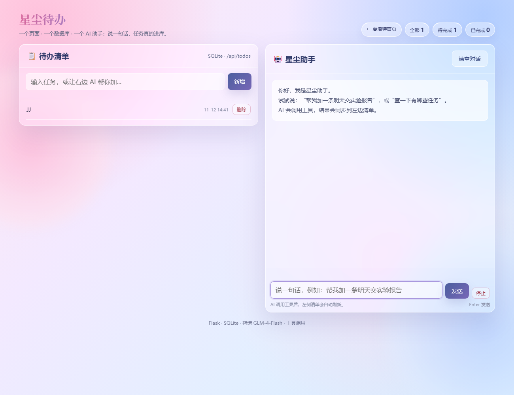
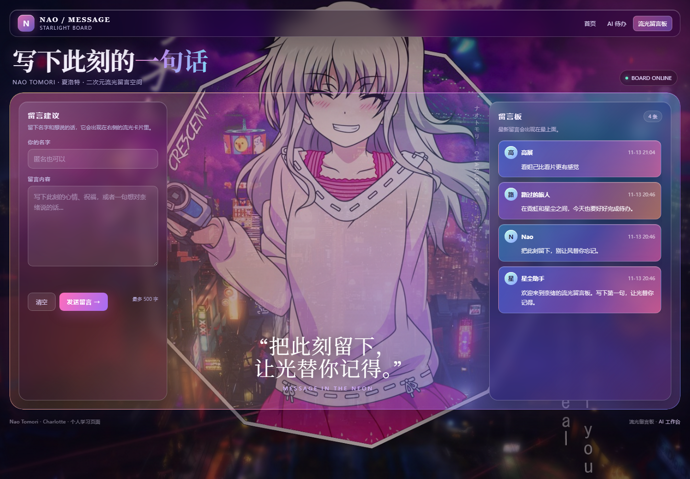

# 夏洛特 AI 待办应用

把原来的「夏洛特静态网页」和「AI 待办助手」合并成一个本地应用：

- 一个启动入口：`启动本地应用.bat`
- 一个 Flask 服务
- 一个 SQLite 数据库 `todos.db`
- 一个 AI 能力：智谱 GLM-4-Flash，支持 `add_item` / `query_items` 工具调用

打开首页是夏洛特网页，采用粉蓝渐变和液态玻璃视觉；点「AI 对话」进入同一个应用里的待办 + AI 工作台。

---

## 1. 解决什么问题

原先的网页、待办接口、AI 对话是分开的几个作业。现在合并成一个能直接使用的本地应用：

- 在首页保留夏洛特个人网页，加入轮播、瀑布流和粉蓝液态玻璃视觉
- 新增城市夜景背景的二次元流光留言板，支持提交、实时刷新和持久化
- 手机端重新排版，导航、轮播、瀑布流、留言板和输入框都可单手操作
- 在「AI 对话」里用自然语言管理待办
- AI 调用工具后，待办列表自动刷新
- 所有任务都落在同一个 `todos.db`

---

## 2. 线上 / 本地地址

本地首页：

```text
http://127.0.0.1:5000/
```

本地 AI 待办工作台：

```text
http://127.0.0.1:5000/app
```

本地流光留言板：

```text
http://127.0.0.1:5000/board
```

线上 AI 待办工作台（PythonAnywhere）：

```text
https://honghuang.pythonanywhere.com/app
```

> 本地和线上使用两个独立的 `todos.db`，数据不互通。

---

## 3. 技术栈

- Python 3.12 + Flask 3.1
- SQLite
- 原生 HTML / CSS / JavaScript
- 智谱开放平台 GLM-4-Flash
- `requests` 负责后端转发 SSE 流
- `python-dotenv` 可选的 `.env` 读取（代码内置了无依赖兜底）

---

## 4. 目录结构

```text
夏洛特AI应用/
├─ app.py                  # Flask 后端：页面、待办 API、AI 工具调用
├─ app.html                # 统一工作台：待办清单 + AI 助手
├─ charlotte/              # 夏洛特网页
│  ├─ index.html
│  ├─ board.html           # 二次元流光留言板
│  ├─ config.js
│  ├─ app.js
│  ├─ demo.js
│  ├─ data.json
│  ├─ bgm.mp3
│  └─ images/
│     └─ nao/
│        ├─ city.jpg       # 流光留言板城市夜景背景
│        └─ ...
├─ todos.db                # SQLite 数据库（todos + messages）
├─ .env                    # API Key，本地使用，不提交
├─ .env.example            # 环境变量示例
├─ .gitignore
├─ requirements.txt
├─ 安装依赖.bat            # 新电脑第一次运行
├─ 启动本地应用.bat
├─ app-home.png            # 工作台截图
├─ charlotte-home.png      # 首页截图
├─ mobile-home.png         # 手机端截图
├─ board-home.png          # 流光留言板截图
└─ README.md
```

---

## 5. 本地运行（10 分钟内）

### 第 1 步：进入目录

```text
C:\Users\honghuang\Desktop\夏洛特AI应用
```

### 第 2 步：第一次先安装依赖

如果是新电脑，双击：

```text
安装依赖.bat
```

它会自动：

- 创建 `.venv`
- 安装 Flask、requests
- 从 `.env.example` 生成 `.env`

### 第 3 步：配置 Key

打开 `.env`，填入：

```text
LLM_API_KEY=你的智谱Key
LLM_BASE_URL=https://open.bigmodel.cn/api/paas/v4
LLM_MODEL=glm-4-flash
MAX_CONTEXT_CHARS=6000
MAX_OUTPUT_TOKENS=800
```

当前电脑上的 `.env` 已配置好，可直接使用。  
发送版压缩包故意不包含 `.env`，对方需要自己填 Key。

### 第 4 步：启动

双击：

```text
启动本地应用.bat
```

它会自动打开：

```text
http://127.0.0.1:5000/
```

### 手动运行（可选）

```powershell
cd "C:\Users\honghuang\Desktop\夏洛特AI应用"
.\.venv\Scripts\python.exe app.py
```

然后打开：

```text
http://127.0.0.1:5000/
```

---

## 6. 功能截图

### 夏洛特首页（粉蓝液态玻璃）

首页使用半透明玻璃卡片、粉蓝渐变背景和浮动光斑；新增的友利奈绪图片放在 `charlotte/images/nao/`。

- 顶部是自动播放的精选轮播，支持按钮、圆点和手机滑动切换
- 下方是两到三列的瀑布流，保留每张图片的原始比例
- 手机端会自动压缩导航、改成两列瀑布流，并让按钮保持 44px 触控高度



### 手机端



### AI 待办工作台



### 二次元流光留言板

以城市夜景为背景，左右两块玻璃面板、中间留白、流光渐变边框；留言会写入 SQLite 的 `messages` 表。



---

## 7. 使用方式

1. 打开 `http://127.0.0.1:5000/`
2. 点「AI 对话」标签，或直接打开 `/app`
3. 输入：

```text
帮我加一条明天交实验报告
```

4. 右侧出现工具调用日志：

```text
调用工具: add_item
参数: {"title":"明天交实验报告"}
执行结果: {"ok":true,"item":{...}}
```

5. 左侧待办列表自动刷新，数据库真的多一条。

也可以说：

```text
查一下有哪些任务
```

AI 会调用 `query_items` 并总结结果。

---

## 8. 接口

| 方法 | 路径 | 说明 |
|---|---|---|
| GET | `/api/todos` | 获取任务列表 |
| POST | `/api/todos` | 新增任务 |
| PUT | `/api/todos/<id>` | 修改任务 |
| DELETE | `/api/todos/<id>` | 删除任务 |
| POST | `/api/chat` | AI 流式对话，支持工具调用 |
| GET | `/api/messages` | 获取留言列表，支持 `limit` |
| POST | `/api/messages` | 新增留言，字段 `name`、`content` |
| GET | `/app` | AI 待办工作台 |
| GET | `/board` | 二次元流光留言板 |
| GET | `/` | 夏洛特首页 |

所有接口统一返回：

```json
{"code": 0, "data": {}, "msg": "ok"}
```

---

## 9. 已知问题

- 本地和线上数据库独立，不会自动同步。
- PythonAnywhere 免费实例会休眠，第一次打开可能较慢。
- 免费站点需要定期点 `Run until 1 month from today` 保活。
- AI 调用依赖网络和 API 余额；401/429/余额不足会在页面提示。
- SQLite 适合单机/课程项目，不适合多实例并发写入。
- 线上流式输出受 PythonAnywhere 代理影响，极端情况下可能分批到达。

---

## 9.1 图片来源

留言板背景使用用户提供的城市夜景图；页面中的友利奈绪图片来自公开网络，仅用于个人学习和页面展示：

- [哲风壁纸：海边晴空友利奈绪](https://haowallpaper.com/homeViewLook/15975174268505472)
- [壁纸次元：海边笑颜友利奈绪](https://www.bizhiciyuan.com/wallpaper/cmmaku0x501odb8qjlfsky955)
- 新浪图库、堆糖等公开图片搜索结果

如果用于公开商业发布，请替换为有明确授权的素材。

## 10. 演示录屏

```text
demo/夏洛特AI应用演示.mp4
```

录屏结构：

1. 问题背景：网页、待办、AI 分散
2. 功能演示：首页 → AI 对话 → 自然语言新增 → 列表刷新
3. 技术要点：Flask 同源、SQLite、SSE 流、工具调用
4. 踩过的坑：Key 隔离、CORS、PythonAnywhere 部署

---

## 11. 快速验收

1. 双击 `启动本地应用.bat`
2. 打开 `http://127.0.0.1:5000/`
3. 点「AI 对话」
4. 输入 `帮我加一条明天交实验报告`
5. 看到工具日志，左侧列表多一条
6. 打开 `http://127.0.0.1:5000/api/todos` 确认数据存在
